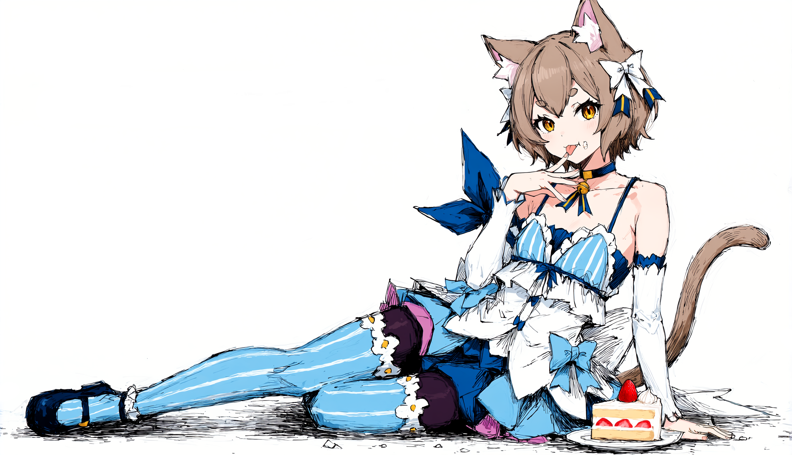

<div align="center">


# huix

**My NixOS flake: a desktop with NVIDIA and CUDA, a laptop on Hyprland and a home server without a screen** （´ω｀♡%）


[](ASSETS.md)
[](WORKAROUNDS.md)
[](DEVIATIONS.md)
[](PITFALLS.md)
[](LICENSE)
[](https://github.com/rokokol/huix/actions/workflows/eval.yml)
[](https://deepwiki.com/rokokol/huix)

<a href="https://github.com/rokokol/huix"></a>

</div>

In short, this is my NixOS for a work PC, a laptop and a home server: Hyprland, nixvim and a pile of everyday applications. Some programs I keep outside the configuration, and for everything else I try to build a comfortable environment of my own

## Commands

```sh
sudo nixos-rebuild switch --flake .#nixos-pc   # or .#nixos-laptop
rebuild                                        # the same alias for the current host
rebuilds                                       # the same, but packages from the Yandex mirror, when the network misbehaves
```

The station keeps no checkout of its own: the PC builds it and ships it over Tailscale SSH

```sh
nixos-rebuild switch --flake .#nixos-station --target-host rokokol@nixos-station --sudo --ask-sudo-password
nix build .#station-boot-test -L      # the station in virtual machines beside a router and the PC, only on request
nix build .#station-install-test -L   # its installer image in virtual machines: the refusals, then a full install
```

The station installs from a flash drive. The [installation guide](docs/guides/install-station.md) explains the image and its secrets. What the station can do is in [the system layer](nixos/README.md#the-station)

If the hardware changed, inspect the output of `sudo nixos-generate-config --show-hardware-config` on that host before you update its hardware configuration. Preserve the existing file until you have reviewed the changes

MATLAB runs through Nix too (★^O^★):

```sh
nix run gitlab:doronbehar/nix-matlab#matlab-shell
nix shell gitlab:doronbehar/nix-matlab#matlab --command /run/media/rokokol/MATHWORKS_R2025A/install
```

## Hosts

| Host | Purpose |
| ---- | ------- |
| Work PC | A work host for development and creative tasks |
| Convertible laptop | A work host with a touchscreen, a pen and a tablet mode |
| Home server | Keeps the backups, assembles the state of the hosts and serves the household services |

## Repository map

The configuration is split into layers, and each layer has its own README:

[](nixos/README.md)
[](nixos/services/README.md)
[](nixos/fonts/README.md)
[](home-manager/README.md)
[](home-manager/desktop/hyprland/README.md)
[](home-manager/programs/README.md)
[](home-manager/programs/nixvim/README.md)
[](scripts/README.md)

## Extracted into their own repositories

The pieces that outgrew the configuration live in flakes of their own: huix takes them as inputs and keeps one seam for each. The whole family, the configuration itself included, carries the [huix](https://github.com/topics/huix) topic

[](https://github.com/rokokol/hyprland-screen-shader)
[](https://github.com/rokokol/rofi-wooordhunt)
[](https://github.com/rokokol/virtual-media-devices)
[](https://github.com/rokokol/skvpn)
[](https://github.com/rokokol/archive-mount.yazi)
[](https://github.com/rokokol/rename-case.yazi)
[](https://github.com/rokokol/ddlc-palette)
[](https://github.com/rokokol/ddlc-sddm-theme)
[](https://github.com/rokokol/ddlc-hyprlock)
[](https://github.com/rokokol/ddlc-rofi-theme)
[](https://github.com/rokokol/ddlc.nvim)
[](https://github.com/rokokol/ddlc-themes)

## A few notes

- The light and the dark theme switch on the fly, and the choice survives reboots and rebuilds
- What runs on the machines is in [the system layer](nixos/README.md) and in the [services](nixos/services/README.md) section

<br/>

---

<div align="center">



<em>an average nixos user :3</em>

<br/>

<table>
<tr><td align="center">

❄️❄️🚀 <b>ALL YOUR PACKAGE MANAGERS ARE SHIT</b> 🤬❄️<br/> MUTABLE GARBAGE 🌋🚀❄️ YOU HAVE TO SWITCH ❄️ TO NIX ❄️❤️<br/> 😍 SWITCH TO NIX ❄️❄️<br/> SWITCH TO NIX, DAMN IT 😡❄️<br/> 🚀 I NEED ❄️❄️ DECLARATIVENESS, DAMN IT 🚀❄️<br/> THE DECLARATIVE NIX APPROACH 😍❤️🚀❄️<br/> ALL YOUR OSES ARE IMPERATIVE 🤬💩 GARBAGE ❄️<br/> ❄️ SWITCH TO NIX

</td></tr>
</table>

<a href="https://никспобеда.рф"></a>

<sub>❄️ made with declarative love · NixOS ❄️</sub>

</div>
