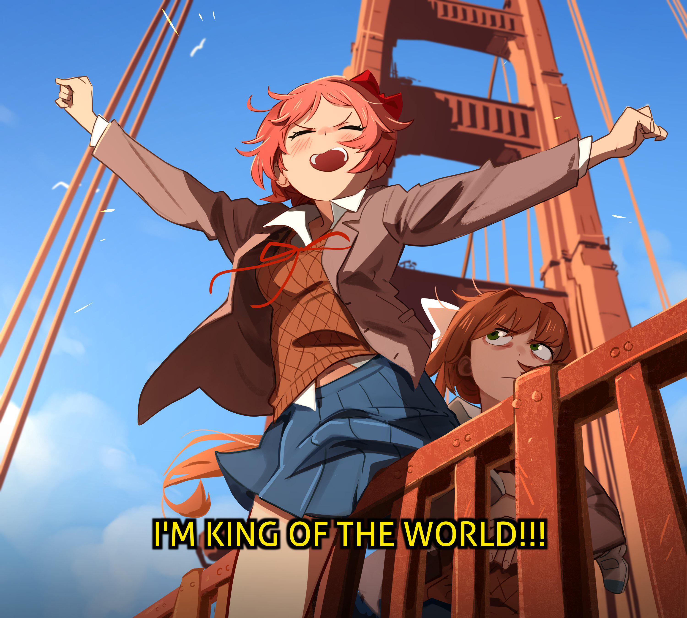

# Fonts

Extra fonts for the system and the applications live here, so that the text of the interfaces and the documents looks the way it should

Some of the fonts follow the look of the desktop, and some simply read well. The third-party font resources are described in [ASSETS.md](../../ASSETS.md), and the whole set arrives only where `rokokol.fonts.enable` is on, which follows the workstation umbrella unless a host says otherwise

## What ships

| Font | Where it comes from | What it is for |
| --- | --- | --- |
| Doki | the files in this directory | the headings of the DDLC theme, a personal-use face by 538Fonts |
| Departure Mono | the files in this directory | the monospace of the whole UI |
| Inter | nixpkgs | a neutral interface sans, the one face here that no module names itself, kept for pages and forms that should not look like the desktop |
| Nunito | nixpkgs | the prose face of the DDLC themes, and the fallback heading face where Doki is absent |
| Mya Nunito | `ddlc-themes` | Nunito with the Greek and the mathematics it lacks on its own, in a variable family and in static weights for apps that read no variation axis |
| Spectral | `google-fonts` | a serif for documents, captions and anything that should not look like an interface |
| Latin Modern | nixpkgs | Computer Modern outside TeX, for maths set by a plotting library and for captions that should read as LaTeX |
| Tiny5 Mono | the `tiny5mono` flake input | a curiosity: a pixel monospace whose LCD, CRT and dot-matrix styles are variation axes of one file |

## Defaults

An application that asks for a generic family gets Departure Mono for its monospace, Mya Nunito for its sans and Spectral for its serif, which is enough for most text that never names a font at all

## Adding one

A font that nixpkgs carries goes into the package list by name. One that nixpkgs does not carry becomes a small derivation here, and the rule for it is that only the font files enter the source: this module and this readme sit in the same directory as the faces, so a derivation pointed at the directory itself rebuilds on every edit to either of them

Latin Modern is the case worth knowing about on the other side: the letters exist inside every plotting library as well, but only an installed family reaches applications that do not bring their own
